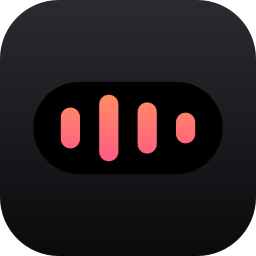
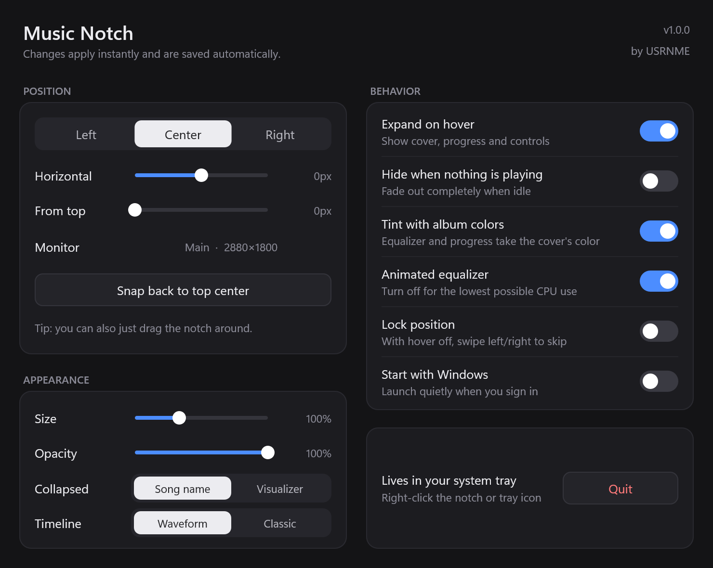

<div align="center">



# Music Notch

[](https://github.com/m-afnan-ali/Music-Notch/actions/workflows/release.yml)
[](LICENSE)

**A tiny, notch-style "now playing" widget for Windows.**
Always on top, buttery animations, and so light you'll forget it's running.

Made by **[USRNME](https://github.com/m-afnan-ali)**


</div>

---

## Features

- **Shows what's playing**: cover art, title and artist in a sleek black notch.
- **Works with almost any player**: Spotify, YouTube and other sites in Chrome, Edge or Firefox, Apple Music, VLC, Windows Media Player, Tidal… anything that appears in the Windows volume flyout.
- **Hover to expand**: a bigger cover, previous / play-pause / next controls, and a One UI 9-style timeline where soft, album-colored hills sway with the music.
- **Visualizer mode**: the collapsed notch can show soft, layered hills that sway with the music instead of the title. Each new song still shows its name for a few seconds first.
- **Fits wherever you put it**: flush into a top corner, a classic notch along the top, or along the bottom edge. In the lower half of the screen it expands upward, so it never goes off-screen.
- **Swipe to skip**: with *Lock position* on and *Expand on hover* off, drag the notch left or right to go to the previous or next song.
- **Reacts to real sound**: the bars follow your actual output level, read from Windows' own volume meter. No audio is recorded.
- **Smooth, physical animations**: spring-based morphing, crossfades between songs, scrolling titles, and colors taken from the album art.
- **Multi-monitor and high-DPI aware**: pick any display, and the notch stays crisp at any scaling.
- **Stays out of your way**: it never steals focus, and clicks pass straight through everything around the pill.
- **Single 350 KB `.exe`**: nothing to install, no runtime needed.

## Featherweight by design

| | Music Notch |
|---|---|
| Memory (private) | **~11.5 MB** |
| CPU while music plays, song-name view | **~1–2% of one core** |
| CPU while music plays, visualizer view | **~1% of one core** |
| CPU with animation off, or when paused | **0%** (the process sleeps) |
| Download size | **~350 KB** |

*Measured on Windows 11 at 200% display scaling.*

How it gets there:

- **Native Rust + Win32**, with no web view, no Electron and no .NET.
- **Software Direct2D** renders into a small bitmap pushed with `UpdateLayeredWindow`, so no GPU device or swap chain is created.
- **Event driven**: Windows notifies the app when the track changes, so it never polls.
- **Animates only when needed**: the frame timer stops the moment nothing is moving.
- **Repaints only the pixels that change.** When only the bars or a scrolling title move, just that strip is redrawn, and the visualizer is drawn straight into the bitmap without Direct2D.
- **The settings window is built on demand** and fully freed when you close it.
- **Trims its working set when idle**, handing unused memory back to Windows.

## Settings



Open it by **left-clicking the tray icon**, or right-click the notch and choose **Settings…**

- **Position**: left corner, center or right corner; offset from the center or edge; distance from the top (all the way down to the bottom edge); which monitor.
- **Appearance**: size (70–160%), opacity, collapsed view (song name or visualizer) and timeline style (waveform hills or a classic bar).
- **Behavior**: expand on hover, hide when nothing is playing, album-color tint, animated equalizer, lock position, and start with Windows.

Settings are saved to `%APPDATA%\MusicNotch\settings.ini`.

## Install

1. Download **`Music-Notch-Setup-<version>.exe`** from the [latest release](https://github.com/m-afnan-ali/Music-Notch/releases/latest).
2. Run it. No admin rights are needed: it installs just for you, adds Music Notch to the Start menu, and can start it when you sign in.
3. The notch appears at the top of your screen, and an icon appears in the system tray.

> **Windows SmartScreen** may warn you the first time, because the app isn't code-signed. Click **More info → Run anyway**.

**Updating:** run the newer setup. It replaces the old version and keeps your settings.

**Uninstalling:** *Settings → Apps → Installed apps → Music Notch → Uninstall*. It removes the app, its shortcuts and its startup entry, and asks whether to keep your settings.

**Portable:** each release also has `Music-Notch-<version>-portable.exe`, a single file you can run from anywhere without installing.

## Usage

| Action | What it does |
|---|---|
| Hover the notch | Expand it to show the cover, progress and controls |
| Drag the notch | Move it (it snaps to the top and bottom edges, the corners and the center) |
| Swipe left / right | Previous / next song (when locked with hover-expand off) |
| Right-click the notch or tray icon | Settings, snap to center, lock, hide, quit |
| Left-click the tray icon | Open Settings |

## Privacy

Music Notch never connects to the internet and has no telemetry. It only reads what Windows already shares about the current track (title, artist, cover and position) and the output volume level. No audio is captured or recorded.

## Troubleshooting

- **Nothing shows up for my player**: the player has to publish to the Windows media controls, the same panel that appears under the volume flyout. Most do. For browsers, the tab has to be playing.
- **The cover is missing for a moment after skipping**: some players publish the new title before the new art. The notch keeps checking for a few seconds and fades the art in when it arrives.
- **It disappeared**: right-click the tray icon and choose *Show notch*, or *Snap to top center*.
- **I want it even lighter**: turn off *Animated equalizer*. The notch then only redraws when something changes.

## Build from source

Requirements: [Rust](https://rustup.rs) 1.84+ (MSVC toolchain) and the Visual Studio Build Tools with the Windows SDK.

```bash
git clone https://github.com/m-afnan-ali/Music-Notch.git
cd Music-Notch
cargo build --release
```

The binary ends up in `target/release/music-notch.exe`.

Developer helpers:

```bash
# Render the README screenshots with a demo track
target/release/music-notch.exe --snapshot docs --demo
# Open the settings window on launch
target/release/music-notch.exe --settings
```

To build the installer too, install [Inno Setup 6](https://jrsoftware.org/isinfo.php) and run
`iscc /DAppVersion=1.0.0 /DAppVersionNum=1.0.0.0 installer\music-notch.iss` (output in `target\installer`).
Releases are built automatically. See [RELEASING.md](RELEASING.md).

`tools/make_icon.py` regenerates `assets/icon.ico` (it needs `pip install PySide6-Essentials`).

### Project layout

```
src/
  main.rs      windows, tray icon, menu, message loop
  notch.rs     the notch: layout, animation, rendering, input
  settings.rs  the custom-drawn settings window
  media.rs     Windows media session reader (background thread)
  audio.rs     output level meter for the visualizer
  gfx.rs       Direct2D / DirectWrite / WIC helpers, colors, monitors
  anim.rs      spring physics
  config.rs    settings file and "start with Windows"
assets/        icon, manifest, version resource template
installer/     Inno Setup script for the installer
docs/          README screenshots (generated with --snapshot --demo)
tools/         icon generator
```

Before opening a pull request, run `cargo fmt` and `cargo clippy --release`. CI checks both.

## Requirements

Windows 10 (version 1809 or later) or Windows 11, 64-bit.

## Author

Designed and built by **[USRNME](https://github.com/m-afnan-ali)**.
If you like it, a ⭐ on the repo is appreciated!

## License

[MIT](LICENSE) © 2026 USRNME
